# Firefly ↔ FALCON workflow comparison

This document traces the local reference implementation at
`C:\Users\marce\Repos\firefly` and the FALCON implementation at
`C:\Users\marce\Repos\FALCON`. Nodes are method-level where the source exposes
the method. Condition nodes represent branches in the current code, not
recommended future behavior.

The `↔` annotations identify the closest corresponding stage in the other
implementation. Firefly is a pair of top-level Python scripts; FALCON exposes
the same fitting path through a hosted CLI and a Blazor Server UI.

## 1. Firefly workflow

```mermaid
flowchart TD
    subgraph FF_ENTRY["Firefly entry points"]
        FF_A["firefly.py<br/>top-level script"] --> FF_CFG["Read inline parameters<br/>resolve age_limits['AoU']"]
        FF_SDSS["firefly_sdss.py<br/>top-level SDSS FITS script"] --> FF_SDSS_READ["Read COADD/SPECOBJ FITS HDUs"]
        FF_A --> FF_ASCII["np.loadtxt(input_file)<br/>read wavelength, flux, error"]
        FF_SDSS_READ --> FF_SETUP
        FF_ASCII --> FF_SETUP["firefly_setup(...)<br/>↔ FALCON: LoadFireflyYaml + DI"]
    end

    subgraph FF_PREP["Input preparation"]
        FF_SETUP --> FF_OPEN["firefly_setup.openSingleSpectrum(...)<br/>↔ FALCON: InitialiseSpectraParameters(...)"]
        FF_OPEN --> FF_VALIDATE{"Array lengths and<br/>flux/error values valid?"}
        FF_VALIDATE -->|no| FF_VALUE["Raise ValueError"]
        FF_VALIDATE -->|yes| FF_REST["Compute restframe_wavelength<br/>and luminosity distance"]
        FF_REST --> FF_MASK["mask_emissionlines(...)<br/>build bad_flags"]
        FF_MASK --> FF_MW{"milky_way_reddening?"}
        FF_MW -->|yes| FF_DUSTMAP["firefly_dust.get_dust_radec(...)<br/>calculate ebv_mw"]
        FF_MW -->|no| FF_NO_MW["Set ebv_mw = 0"]
        FF_DUSTMAP --> FF_MASK_FINAL["Apply final mask<br/>remove bad/emission-line pixels"]
        FF_NO_MW --> FF_MASK_FINAL
    end

    subgraph FF_MODEL["Model preparation"]
        FF_MASK_FINAL --> FF_MODEL_CTOR["StellarPopulationModel.__init__(...)<br/>↔ FALCON: SpectralFitPipeline constructor"]
        FF_MODEL_CTOR --> FF_MODEL_TYPE{"models == 'MaStar'<br/>or 'm11'?"}
        FF_MODEL_TYPE -->|MaStar| FF_MASTAR["get_model(...)<br/>read MaStar_SSP_v0.2.fits.gz<br/>select library, IMF, age, metallicity"]
        FF_MODEL_TYPE -->|m11| FF_M11["get_model(...)<br/>scan SSP_M11_* files<br/>select metallicity and age"]
        FF_MASTAR --> FF_DOWNGRADE["downgrade(...)<br/>match model to velocity/instrument resolution"]
        FF_M11 --> FF_DOWNGRADE
        FF_DOWNGRADE --> FF_MODEL_MW{"ebv_mw != 0?"}
        FF_MODEL_MW -->|yes| FF_ATTEN_MW["unred(..., ebv=-ebv_mw)<br/>apply MW attenuation"]
        FF_MODEL_MW -->|no| FF_MODEL_READY["Keep model flux"]
        FF_ATTEN_MW --> FF_MODEL_READY
    end

    subgraph FF_FIT["Fitting workflow"]
        FF_MODEL_READY --> FF_MATCH["match_data_models(...)<br/>↔ FALCON: StatisticsService.MatchDataModels"]
        FF_MATCH --> FF_NORM["normalise_spec(...)<br/>↔ FALCON: StatisticsService.NormaliseSpec"]
        FF_NORM --> FF_HPF{"hpf_mode?"}
        FF_HPF -->|on| FF_DUST["determine_attenuation(...)<br/>HPF data/models, then fitter(...)"]
        FF_DUST --> FF_LAW{"dust_law?"}
        FF_LAW -->|calzetti| FF_CAL["dust_calzetti_py(...)"]
        FF_LAW -->|allen| FF_ALLEN["Allen attenuation law"]
        FF_LAW -->|prevot| FF_PREVOT["Prevot attenuation law"]
        FF_CAL --> FF_RENORM["Apply attenuation curve<br/>normalise_spec(...) again"]
        FF_ALLEN --> FF_RENORM
        FF_PREVOT --> FF_RENORM
        FF_HPF -->|hpf_only| FF_HPF_ONLY["hpf(...) data/models<br/>force best_ebv = 0<br/>repair invalid HPF pixels"]
        FF_HPF_ONLY --> FF_FITTER["fitter(...)<br/>↔ FALCON: IterativeSpectralFitter.Fit"]
        FF_RENORM --> FF_FITTER
        FF_FITTER --> FF_INIT["Initial one-model fits"]
        FF_INIT --> FF_ITER["iterate(...)"]
        FF_ITER --> FF_CHILDREN["spawn_children(...)<br/>evaluate candidate SSP additions"]
        FF_CHILDREN --> FF_IMPROVE{"Child improves χ²<br/>by BIC threshold?"}
        FF_IMPROVE -->|yes| FF_KEEP["Keep child in fit list"]
        FF_IMPROVE -->|no| FF_DROP["Discard child"]
        FF_KEEP --> FF_STOP{"Improvement remains<br/>and iteration limit not reached?"}
        FF_DROP --> FF_STOP
        FF_STOP -->|yes| FF_ITER
        FF_STOP -->|no| FF_MIX["mix(...)<br/>combine top solutions"]
    end

    subgraph FF_POST["Statistics and output"]
        FF_MIX --> FF_PROBS["convert_chis_to_probs(...)<br/>↔ FALCON: ConvertChisToProbs"]
        FF_PROBS --> FF_MASS["light_weights_to_mass(...)<br/>↔ FALCON: LightWeightsToMass"]
        FF_MASS --> FF_NAN{"mass_weights all NaN?"}
        FF_NAN -->|yes| FF_DUMMY["create_dummy_hdu()<br/>mark non-convergence"]
        FF_NAN -->|no| FF_AVG["calculate_averages_pdf(...)<br/>estimate mass-loss/remnants"]
        FF_AVG --> FF_TABLE["Build BinTableHDU<br/>write fit, PDF, mass, and SSP headers"]
        FF_TABLE --> FF_HDU["Append HDUs and<br/>HDUList.writeto(output_file)"]
        FF_DUMMY --> FF_NO_WRITE["Do not write completed result"]
    end

    FF_VALUE --> FF_CATCH["firefly.py catches ValueError"]
    FF_CATCH --> FF_DUMMY
    FF_HDU --> FF_DONE["Done"]
    FF_NO_WRITE --> FF_DONE

    FF_MODEL_CTOR -. "alternate implemented path" .-> FF_MANGA["openMANGASpectrum(...)<br/>MaNGA MAPS/LOGCUBE/DAPALL path<br/>not invoked by the two main scripts"]
```

### Firefly scope notes

- `firefly.py` and `firefly_sdss.py` execute at import/top level; neither has a
  `main()` guard.
- The standard path is `firefly.py → openSingleSpectrum`; the SDSS script
  supplies FITS-derived arrays to the same downstream model workflow.
- `openMANGASpectrum(...)` exists as a separate loader, but it is not connected
  to either discovered top-level entry script.
- `m11` is implemented in the reference Python code. FALCON's corresponding
  M11 branch is currently incomplete, while MaStar is the active parity path.
- Existing output handling differs by entry point: `firefly.py` prompts before
  replacing an existing file; `firefly_sdss.py` removes its existing output
  unconditionally.

## 2. FALCON workflow

```mermaid
flowchart TD
    subgraph F_HOST["FALCON host entry points"]
        F_CLI["Falcon.Cli/Program.cs<br/>top-level CLI"] --> F_CONFIG["YamlConfigurationExtensions.LoadFireflyYaml(configPath)<br/>↔ Firefly: inline parameters"]
        F_CONFIG --> F_BUILDER["Host.CreateDefaultBuilder(args)<br/>AddFalconCore()"]
        F_BUILDER --> F_GPU["InitializeGpuData(gpu, options, basePath)"]
        F_GPU --> F_DISCOVER{"Spectrum args supplied?"}
        F_DISCOVER -->|yes| F_ARGS["Resolve explicit files"]
        F_DISCOVER -->|no| F_SCAN["Discover input directory<br/>using InputGlob"]
        F_ARGS --> F_FILES{"Any files found?"}
        F_SCAN --> F_FILES
        F_FILES -->|no| F_CLI_ERROR["Log error and return 2"]
        F_FILES -->|yes| F_BATCH["ISpectralFitPipeline.FitBatch(files)<br/>↔ Firefly: repeated script invocation"]

        F_UI["Falcon.UI/Program.cs<br/>Blazor Server host"] --> F_UI_DI["CreateBuilder<br/>AddRazorComponents + AddFalconCore"]
        F_UI_DI --> F_UI_ROUTE["MapRazorComponents<App>()<br/>interactive server render mode"]
        F_UI_ROUTE --> F_RUN["Run.razor: RunSelected()"]
        F_RUN --> F_UI_SELECT{"Selected spectra > 0?"}
        F_UI_SELECT -->|no| F_UI_IDLE["Return"]
        F_UI_SELECT -->|yes| F_UI_BATCH["FalconAnalysisService.RunBatchAsync(...)"]
        F_UI_BATCH --> F_UI_INIT["InitializeGpuData(...)"]
        F_UI_INIT --> F_UI_PARALLEL["Parallel.ForEach selected files<br/>progress/status updates"]
    end

    F_BATCH --> F_RUNNER["SpectralFitRunner.FitBatch(...)<br/>↔ Firefly: outer input loop"]
    F_UI_PARALLEL -->|"pipeline FitFile"| F_FILE
    F_RUNNER --> F_PARALLEL{"Batch paths empty?"}
    F_PARALLEL -->|yes| F_BATCH_ERROR["Throw InvalidOperationException"]
    F_PARALLEL -->|no| F_FILE["SpectralFitRunner.FitFile(...)"]
    F_FILE --> F_SHUTDOWN{"FalconFitSession.IsShutdown?"}
    F_SHUTDOWN -->|yes| F_SHUTDOWN_ERROR["Throw InvalidOperationException"]
    F_SHUTDOWN -->|no| F_READY["FalconGpuHost.EnsureReady(gpu)"]
    F_READY --> F_READ["FitsSpectrumReader.ReadDataFits(...)<br/>↔ Firefly: np.loadtxt/FITS read"]
    F_READ --> F_PIPE_CTOR["new SpectralFitPipeline(...)"]
    F_PIPE_CTOR --> F_INIT["SpectralFitPipeline.InitialiseSpectraParameters(...)<br/>↔ Firefly: openSingleSpectrum(...)"]
    F_INIT --> F_MW{"Milky_Way_Reddening?"}
    F_MW -->|yes| F_MW_DUST["GetDustRADEC(...) → Get_SFD_dust(...)"]
    F_MW -->|no| F_MW_ZERO["Set Ebv_MW = 0"]
    F_MW_DUST --> F_REST["Compute Restframe_Wavelength<br/>and Distance_Luminosity"]
    F_MW_ZERO --> F_REST
    F_REST --> F_MASK["BuildGoodDataMask(...)<br/>ApplyGoodDataMask(...)"]
    F_MASK --> F_VALID{"Any valid spectral pixels remain?"}
    F_VALID -->|no| F_INPUT_ERROR["Throw InvalidOperationException"]
    F_VALID -->|yes| F_MODEL_INIT["InitialiseSPModel()"]
    F_MODEL_INIT --> F_FIT["SpectralFitPipeline.Fit_models_to_data()<br/>↔ Firefly: fit_models_to_data(...)"]

    subgraph F_MODELS["Model construction"]
        F_FIT --> F_GET_MODEL["Get_Model()"]
        F_GET_MODEL --> F_MODEL_KEY{"LegacyConfig.Model_Key % 2 == 1?"}
        F_MODEL_KEY -->|yes| F_M11["M11 branch<br/>currently incomplete/returns"]
        F_MODEL_KEY -->|no| F_MASTAR["MaStar branch<br/>FireflyConstants model grid"]
        F_MASTAR --> F_TRIM["TrimModel()"]
        F_TRIM --> F_RES["DownGradeModelInvar(...)<br/>resolution matching/convolution"]
        F_RES --> F_MODEL_ATTEN{"Ebv_MW != 0?"}
        F_MODEL_ATTEN -->|yes| F_MODEL_RED["DustService.FitzpatrickUnred(...)<br/>apply MW attenuation"]
        F_MODEL_ATTEN -->|no| F_MODEL_KEEP["Keep model flux"]
        F_MODEL_RED --> F_MODEL_READY["Build Model_flux, Model_ages,<br/>Model_metals, Mass_factor inputs"]
        F_MODEL_KEEP --> F_MODEL_READY
        F_MODEL_READY --> F_ENGINE{"LegacyConfig.FittingEngine?"}
        F_ENGINE -->|legacy_gpu| F_LEGACY["RunLegacyGpuPath()"]
        F_ENGINE -->|firefly/default| F_CONTEXT["BuildFireflyContext()<br/>↔ Firefly matched model context"]
        F_CONTEXT --> F_ORCH["FireflyFitOrchestrator.TryFit(...)"]
        F_ORCH --> F_ORCH_RESULT{"Fit succeeded?"}
        F_ORCH_RESULT -->|no| F_FALLBACK{"LegacyGpuFallback?"}
        F_ORCH_RESULT -->|yes| F_RETURN["Return from Fit_models_to_data()"]
        F_FALLBACK -->|yes| F_LEGACY
        F_FALLBACK -->|no| F_RETURN
    end

    subgraph F_LEGACY_PATH["FALCON legacy GPU path"]
        F_LEGACY --> F_LEGACY_NORM["NormaliseSpec()"]
        F_LEGACY_NORM --> F_LEGACY_HPF{"HPF_Mode?"}
        F_LEGACY_HPF -->|yes| F_LEGACY_DUST["RunDustAttenuationPipeline()"]
        F_LEGACY_HPF -->|no| F_LEGACY_CHI["GenerateInterpSSP()"]
        F_LEGACY_DUST --> F_LEGACY_CHI
        F_LEGACY_CHI --> F_LEGACY_OUTPUT["RecordData(...)<br/>legacy text output"]
        F_LEGACY_OUTPUT --> F_RETURN
    end

    subgraph F_FIREFLY_PATH["FALCON firefly-compatible path"]
        F_ORCH --> F_GRID{"ModelsOnDataGrid?"}
        F_GRID -->|false| F_MATCH["StatisticsService.MatchDataModels(...)<br/>↔ Firefly: match_data_models(...)"]
        F_GRID -->|true| F_GRID_USE["Use existing data-grid arrays"]
        F_MATCH --> F_NORMALIZE["StatisticsService.NormaliseSpec(...)<br/>↔ Firefly: normalise_spec(...)"]
        F_GRID_USE --> F_NORMALIZE
        F_NORMALIZE --> F_HPF{"HPF_Mode / HpfOnlyMode?"}
        F_HPF -->|HPF_Mode true| F_DUST["DustService.DetermineAttenuation(...)<br/>↔ Firefly: determine_attenuation(...)"]
        F_DUST --> F_DUST_RENORM["Apply attenuation curve<br/>NormaliseSpec(...) again"]
        F_HPF -->|HpfOnlyMode true| F_HPF_ONLY["DustService.Hpf(data/models)<br/>repair invalid pixels<br/>set best E(B-V) = 0"]
        F_HPF_ONLY --> F_HPF_RENORM["NormaliseSpec(...) on HPF data/models"]
        F_HPF -->|both false| F_DIRECT["Fit normalized models directly"]
        F_DUST_RENORM --> F_ITER["IterativeSpectralFitter.Fit(...)<br/>↔ Firefly: fitter(...)"]
        F_HPF_RENORM --> F_ITER
        F_DIRECT --> F_ITER
        F_ITER --> F_EVAL{"UseGpuEvaluator<br/>and GPU available?"}
        F_EVAL -->|yes| F_GPU_EVAL["GpuChiSquaredEvaluator"]
        F_EVAL -->|no| F_CPU_EVAL["FloatChiSquaredEvaluator"]
        F_GPU_EVAL --> F_INITIAL["Initial one-model fits"]
        F_CPU_EVAL --> F_INITIAL
        F_INITIAL --> F_ITERATE["Iterate(...)"]
        F_ITERATE --> F_SPAWN["SpawnChildren(...)"]
        F_SPAWN --> F_BIC{"Child improves χ²<br/>beyond BIC threshold?"}
        F_BIC -->|yes and cap available| F_ADD["Add child to fit list"]
        F_BIC -->|no| F_NOT_ADD["Discard child"]
        F_ADD --> F_CONVERGE{"New children == 0<br/>or MaxIterations reached?"}
        F_NOT_ADD --> F_CONVERGE
        F_CONVERGE -->|no| F_ITERATE
        F_CONVERGE -->|yes| F_MIX{"ExperimentalMixSearch?"}
        F_MIX -->|yes| F_GOLDEN["MixGoldenSection(...)"]
        F_MIX -->|no| F_EXACT["MixFireflyExact(...)"]
        F_GOLDEN --> F_SORT["Sort solutions by χ²"]
        F_EXACT --> F_SORT
        F_SORT --> F_STATS["ConvertChisToProbs(...)<br/>LightWeightsToMass(...)<br/>CalculateAveragesPdf(...)<br/>↔ Firefly statistics sequence"]
        F_STATS --> F_MASS_VALID{"Any NaN mass weights?"}
        F_MASS_VALID -->|yes| F_FIT_FAIL["Return false"]
        F_MASS_VALID -->|no| F_RESULT["Build FireflyFitOutput<br/>best fit, solutions, PDFs, masses"]
        F_RESULT --> F_WRITE{"LegacyConfig.Write_Results?"}
        F_WRITE -->|yes| F_WRITE_FILES["FalconResultsWriter.Write(...)<br/>IFireflyFitsWriter.WriteResults(...)"]
        F_WRITE -->|no| F_NO_FILES["Return output without result files"]
        F_WRITE_FILES --> F_RETURN_TRUE["Return true"]
        F_NO_FILES --> F_RETURN_TRUE
    end

    F_BATCH_ERROR --> F_HOST_ERROR["Host logs failure"]
    F_SHUTDOWN_ERROR --> F_HOST_ERROR
    F_INPUT_ERROR --> F_FILE_ERROR["FitFileCore catches/logs failure"]
    F_FIT_FAIL --> F_ORCH_FAIL["TryFit catches/logs exception or returns false"]
    F_RETURN_TRUE --> F_UI_RESULT["CLI/UI receives completion and result status"]
    F_RETURN --> F_UI_RESULT
    F_HOST_ERROR --> F_END["End"]
    F_FILE_ERROR --> F_END
    F_UI_RESULT --> F_END
```

### FALCON scope notes

- CLI and Blazor Server are separate hosts that converge on
  `SpectralFitRunner.FitBatch(...)` / `FitFile(...)`; no separate REST controller
  workflow was found.
- The default `firefly` engine uses `FireflyFitOrchestrator`; `legacy_gpu` is
  retained for compatibility and can also be selected as a fallback.
- `ModelsOnDataGrid` is currently built as `true` by `BuildFireflyContext()`,
  so the normal default path skips a second wavelength-grid match after model
  construction. The branch remains explicit in the orchestrator.
- The active model implementation is MaStar. The M11 branch in
  `SpectralFitPipeline.Get_Model()` is present but incomplete.
- The UI adds selection, progress, cancellation, and result-summary states
  around the same batch pipeline; those states are not part of Firefly's
  script-level workflow.

## 3. Stage correspondence

| Firefly reference | FALCON counterpart | Main difference |
|---|---|---|
| `firefly.py` / `firefly_sdss.py` | `Falcon.Cli/Program.cs`, `Falcon.UI/Program.cs` | Two hosted entry surfaces replace top-level scripts |
| `firefly_setup.openSingleSpectrum(...)` | `SpectralFitPipeline.InitialiseSpectraParameters(...)` | GPU vectors, DI services, and explicit quality masking |
| `get_dust_radec(...)` | `GetDustRADEC(...)` → `Get_SFD_dust(...)` | Dust maps are served through FALCON's dust service |
| `StellarPopulationModel.get_model(...)` | `SpectralFitPipeline.Get_Model()` | MaStar parity path is ported; M11 remains incomplete |
| `match_data_models(...)` | `StatisticsService.MatchDataModels(...)` | FALCON can skip matching when models are already on the data grid |
| `normalise_spec(...)` | `StatisticsService.NormaliseSpec(...)` | Same normalization/mass-factor role |
| `determine_attenuation(...)`, `hpf(...)` | `DustService.DetermineAttenuation(...)`, `DustService.Hpf(...)` | FALCON exposes dust behavior through injected services |
| `fitter(...)`, `iterate(...)`, child expansion, `mix(...)` | `IterativeSpectralFitter.Fit(...)`, `Iterate(...)`, `SpawnChildren(...)`, `MixFireflyExact(...)` / `MixGoldenSection(...)` | FALCON selects CPU/GPU evaluation and optionally experimental mixing |
| `light_weights_to_mass(...)` | `LightWeightsToMass(...)` | Same post-fit conversion |
| `convert_chis_to_probs(...)`, `calculate_averages_pdf(...)` | `ConvertChisToProbs(...)`, `CalculateAveragesPdf(...)` | Same PDF/statistics stage |
| `HDUList.writeto(...)` | `FalconResultsWriter.Write(...)` and `IFireflyFitsWriter.WriteResults(...)` | FALCON can emit JSON plus FITS-sidecar output |
